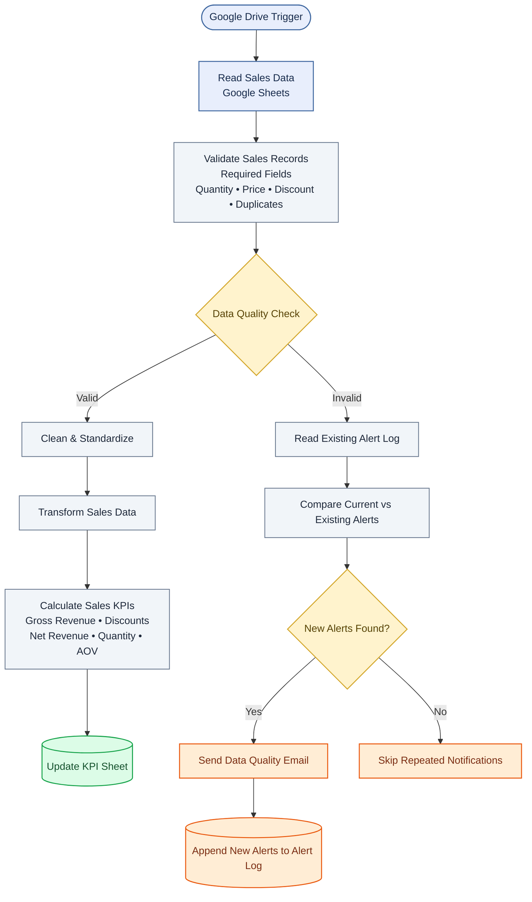

# Sales Data Automation & Data Quality Monitoring with n8n

## Overview

An automated sales data workflow built with **n8n and Google Sheets** to validate sales records, identify data quality issues, prevent repeated alerts, and maintain key business performance metrics.

## Business Problem

Manual sales data processing can lead to inconsistent records, invalid transactions, duplicate orders, and unreliable reporting. Repeated data quality notifications can also create unnecessary noise for business teams.

## Solution
## Workflow Architecture

This project implements an automation workflow that:

- **Validates sales records** for missing required fields, invalid quantities, invalid prices, discount violations, and duplicate order IDs.
- **Cleans and transforms data** before calculating business metrics.
- **Calculates sales KPIs**, including gross revenue, discounts, net revenue, total quantity, and average order value.
- **Updates KPI reporting** in Google Sheets using a matching report identifier.
- **Tracks new data quality issues** by comparing current issues against an alert log.
- **Sends email notifications** for newly detected issues and records them for follow-up.

## Workflow Architecture

Google Drive / Google Sheets → Data Validation → Conditional Routing

- **Valid records:** Cleaning → Transformation → KPI Calculation → KPI Sheet Update
- **Invalid records:** Existing Alert Lookup → New Alert Detection → Email Notification → Alert Log

## Technology Stack

- n8n — workflow automation
- Google Sheets — source data, KPI reporting, and alert logging
- JavaScript — validation, transformation, and alert deduplication
- Gmail / SMTP — email notifications
- GitHub — version control and documentation

## Testing & Validation

Test scenarios include:

- Missing required fields
- Zero or negative quantities and prices
- Invalid discount values
- Duplicate order IDs
- Prevention of repeated alerts for previously logged issues
- KPI calculation and Google Sheets updates
- Email notification delivery

## Key Outcomes

- Automated sales data quality checks
- Centralized KPI reporting
- Traceable data quality issues
- Reduced repeated notifications through alert deduplication

## Project Status

Core validation, KPI update, and repeated-alert prevention scenarios have been tested. Additional edge-case testing is required before describing the workflow as production-ready.

## Repository Contents

- `workflow/` — exported n8n workflow
- `docs/` — architecture and screenshots
- `sample-data/` — synthetic test data

